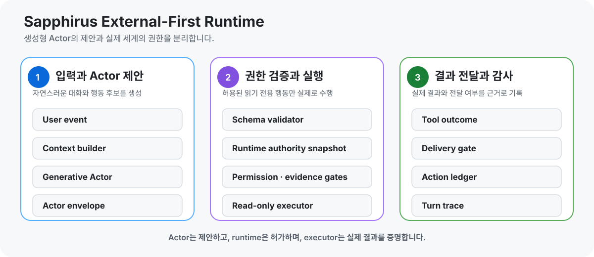

# Rubrum & Sapphirus — Personal AI Model Training

나와 대화하고 함께 게임하는 개인용 한국어 AI 컴패니언을 목표로, 공개 사전학습 모델 위에 서로 다른 생성 방식의 적응 학습을 진행하는 포트폴리오입니다.

**2026-10-30 현재 구조·학습·평가 갱신:** 현재 연구의 중심은 **Rubrum의 SDAR-4B-Chat 디퓨전**과 **Sapphirus의 Qwen3.5-4B 자기회귀(AR)**입니다. 이전 BERT·Qwen3-8B 구조와 당시 실험은 아래 연구 이력에 보존했습니다.

| 프로젝트 | 현재 기반 모델·방식 | 현재 학습 주제 |
| --- | --- | --- |
| **Rubrum** | JetLM/SDAR-4B-Chat · 디퓨전 계열 | 균일 토큰 노이즈 복원, LoRA와 self-conditioning을 통한 생성 적응 |
| **Sapphirus** | Qwen3.5-4B · AR | Chat 누적 LoRA SFT, 별도 Minecraft Game LoRA, 외부 근거에 맞는 상태 설명 |

## 직접 살펴보기: Rubrum 생성 과정

**[디퓨전 Trace 뷰어 실행](https://snvoosy-arch.github.io/ai-companion-response-learning/diffusion-trace/)** — 256개 토큰이 답변으로 복원되는 실제 저장 기록을 단계별로 살펴봅니다. 제련 수량을 맞힌 사례와 수령을 잘못 단정한 사례를 함께 공개합니다.

GPU·API 키 없이 실행되는 정적 HTML입니다. GitHub Pages에서 열거나 [실행 안내](docs/diffusion-trace/README.md)에 따라 내려받아 실행할 수 있습니다. 직접 작성한 합성 평가 상황의 실제 모델 출력 2건이며, 전체 성능을 대표하지 않습니다.

## 직접 살펴보기: Sapphirus 실제 답변

**[사피루스 답변 비교 뷰어](https://snvoosy-arch.github.io/ai-companion-response-learning/sapphirus/)** — 같은 요청과 외부 상태에 대한 r7/누적 Chat의 실제 저장 답변을 비교합니다. 선별한 합성 평가 6건에서 개선과 남은 오류를 함께 보여주며, 근거 충족과 표현 품질을 구분합니다. GPU·API 키 없이 동작합니다.

[두 프로젝트 뷰어 입구](https://snvoosy-arch.github.io/ai-companion-response-learning/) · [현재 Sapphirus 구조·검증 범위](docs/sapphirus-current-architecture.md) · [새 CPU 실행 예제](examples/sapphirus_current/README.md)

## 먼저 볼 자료

- [Rubrum 현재 구조·게임 연결·검증 범위](docs/rubrum-current-architecture.md)
- [현재 모델·학습·평가 상세](docs/current-model-training.md)
- [공개 가능한 최신 근거 집계](evidence/model-training/current-summary.json)
- [이전 Rubrum 케이스스터디](docs/rubrum-case-study.md)
- [이전 Sapphirus 케이스스터디](docs/sapphirus-case-study.md)
- [기존 공개 구현·CPU 예제](companions/README.md)

## 최근 학습에서 확인한 것

**Rubrum**은 증류 대화 전체 학습(20,830개 대화·22,284개 assistant 대상) 이후, 게임 근거 대화 450행을 같은 256 uniform + SC 조건으로 누적 학습했습니다. 게임 본문 복원 loss는 **1.842505 → 1.671623**이며, 실제 생성에는 수량·수령 단정 오류가 남았습니다. 작은 전후 답변 표본으로 전체 개선·악화를 확정하거나 자동 롤백하지 않습니다. 별도 게임 의미 모델의 목표 전체 일치는 **117/200**이며, 대화 생성 평가와 구분합니다.

**Sapphirus**는 일상 대화 24,030개를 학습한 r7에서 Minecraft 상황 대화 200개를 추가 학습했습니다. 현재 Chat은 이 누적본이며 다음 학습도 여기서 이어갑니다. 새 50문항의 상태 설명 사용 가능 판정은 **26/50 → 33/50**, 같은 개발 50문항 loss는 **2.1422 → 1.6469**입니다. 별도 Game LoRA 최종 출력은 32/50이지만 실제 게임 수행 성적과 구분합니다. 일상 12건의 작은 진단으로 일반 대화 성능의 상승·하락을 확정하지 않습니다.

이 두 실험은 데이터·학습 목표·평가 방식이 다릅니다. 결과를 디퓨전과 AR의 공정한 우열 비교로 해석하지 않습니다.

## 학습 결과와 실행 구성

Rubrum은 256 uniform + SC 대화 LoRA와 별도 GameLoRA·의미 헤드를 연구합니다. 최신 의미 모델을 실제 Minecraft 서버 관찰에 연결해 제한된 소지품 조회·이동을 시험했지만, 모든 행동의 학습 기반 선택이나 일반 게임 채팅부터의 전체 파이프라인 성공을 검증한 것은 아닙니다. 학습된 행동 후보 Ranker는 아직 없습니다.

학습된 4B 대화 후보의 Discord 연결도 별도로 시험한 뒤 종료했습니다. 이번 포트폴리오 갱신은 모델·서버를 실행하지 않습니다. Sapphirus는 10월 29일 학습된 r7의 제한된 Discord 연결을 시험한 뒤 종료했습니다. 다음 실행의 기본 선택은 최신 누적 Chat이지만 현재 서비스 접속을 뜻하지 않습니다. 최신 Game smoke 시험은 인자 계약으로 두 행동이 거절돼 이동·채집 0회였으며, Chat/Game 전체 실행 루프 통합은 남아 있습니다. inZOI는 후속 연결 후보입니다.

## 공개 범위

이 저장소는 현재 모델 연구의 설명·선별한 집계와 이전 공개 구현을 제공합니다. 최신 학습 코드 전체, 모델 가중치, 학습 원문과 개인 대화는 포함하지 않습니다. 뷰어에는 선별한 합성 평가의 Rubrum token Trace 2건과 Sapphirus 학습 전후 답변 6쌍의 입력·상태·출력을 공개합니다. Sapphirus의 생성 token Trace를 합성하지 않습니다. 공개 집계의 원본 파일 해시는 추적을 위한 식별값이며, 공개된 파일만으로 최신 학습을 재현할 수 있다는 뜻은 아닙니다.

## 이전 구조와 실험 이력

아래 자료는 BERT 기반 Rubrum과 Qwen3-8B 기반 Sapphirus의 이전 연구 기록입니다. 당시의 ‘현재’, 실행 상태, 성적은 해당 실험 시점을 뜻합니다. 새 기반 모델의 성적으로 이전하지 않습니다.

<details>
<summary>이전 아키텍처 포트폴리오 펼치기</summary>

## AI Companion Architecture Portfolio — 이전 계보

서로 다른 책임 구조로 동작하는 두 한국어 AI companion을 구현하고 검증하는 개인 연구 포트폴리오입니다.

| Companion | 중심 구조 | 자세히 보기 |
|---|---|---|
| **Rubrum** | encoder 기반 의미 판단 + 명시적 상태·정책 + 제한적 단어·형태소 조립 | [Rubrum 케이스스터디](docs/rubrum-case-study.md) |
| **Sapphirus** | 생성형 Actor + 외부 권한·실행·증거 계층 | [Sapphirus 케이스스터디](docs/sapphirus-case-study.md) |

두 프로젝트 모두 단순히 좋은 답변 하나를 고르는 대신, 독립 평가와 단계적 권한 승격을 사용합니다. 차이는 문맥을 읽을 수 있느냐가 아니라 의미 판단·행동 선택·표현 책임을 어디에 두느냐입니다.

## Rubrum — Judgment and State-Centered Companion

Rubrum은 의미 해석, grounding, 상태, 반응 결정, 내용 계획, 표면 표현, 결과 관찰을 독립된 계약으로 분리합니다. 검증되지 않은 모델과 후보에는 실제 출력권을 주지 않습니다.

| 단계 | 책임 | 주요 구성요소 |
|---:|---|---|
| 1 | 입력 의미 해석 | User / Event, MeaningBERT-A, MeaningPacket |
| 2 | 사실과 상태 확정 | Grounding, WorldState |
| 3 | 반응과 표현 계획 | ReactionDecision, ContentPlan, Concept / Lexical Planning |
| 4 | 후보 검증과 실행 | Surface Candidates, Semantic / Morphology Gate, Verifier / Authority Gate, Discord / Action |
| 5 | 결과 관찰 | Outcome, Transition Shadow |

### Rubrum의 현재 경계

- `CORE`: MeaningPacket, verifier, DecisionTrace·Outcome 공통 계약
- `CORE 전환 중`: ReactionDecision·ContentPlan 단일 책임 구조와 legacy 경로의 병행 전환
- `CANARY`: 검토된 일부 관계 비유와 단어·형태소 조립 반응군
- `SHADOW`: 결정론적 transition prediction과 실제 관찰 비교
- `RESEARCH`: SurfaceBERT-B. 어휘 의미 선택 heldout 실패로 실제 출력권 없음
- `FUTURE`: learned world model, planner, broad open-domain atomic NLG

<!-- evidence:surface_bert_b_lexical_fit_v1 metrics=dev_top1,independent_heldout_top1 -->
대표적으로 SurfaceBERT-B 어휘 ranker는 dev `5/6`에서 독립 heldout `2/6`으로 무너졌습니다. 추가 epoch으로 밀어붙이지 않고 의미 적격성을 구조적 hard gate로 이동하고 모델의 책임을 동일 의미 후보의 잔여 표현 선호로 축소했습니다.
<!-- /evidence -->

### Rubrum CPU 수직 표본

공개 예제는 검수된 MeaningPacket 이후의 흐름만 재현하며, 공개되지 않은 MeaningBERT checkpoint가 추론에 성공했다고 가장하지 않습니다.

```powershell
cd companions\rubrum
python -m examples.rubrum_vertical_slice.demo
python -m unittest discover -s tests -p "test_*.py" -v
python scripts\audit_public_portfolio.py
```

- [Rubrum 아키텍처](docs/rubrum-architecture.md)
- [Rubrum 공개 주장 상태표](docs/rubrum-claim-status.md)
- [Rubrum 실험 원장](docs/rubrum-experiment-ledger.md)
- [Rubrum 실행 안내](companions/rubrum/README.md)

---

## Sapphirus — External-First Generative AI Companion

Sapphirus는 생성형 LLM에게 대화와 `reply · silence · use_tool` 제안권을
유지하면서, 권한·실행·증거·전달의 사실성은 외부 런타임이 보장하도록 책임을
분리한 한국어 AI 컴패니언 프로젝트입니다.

**2026-09-11 기준:** frozen Qwen3-8B 후보를 유지하고 있습니다. RAG 후보 평가는
거절됐으며, Minecraft에서는 실행기 이동과 모델의 도구 선택을 분리해 시험 중입니다.
학습·후보 승격·active runtime 교체는 동결 상태입니다.

### 빠르게 살펴보기

| 보고 싶은 내용 | 시작점 |
| --- | --- |
| 어떤 문제를 해결했고 왜 설계를 바꿨는가 | [케이스스터디](docs/sapphirus-case-study.md) |
| 실제로 실행해 볼 수 있는 코드는 무엇인가 | [RAG·Minecraft 구현](companions/sapphirus/README.md) · [CPU 계약 예제](examples/sapphirus_external_first/README.md) |
| 최근 RAG·Minecraft 실험에서 무엇을 확인했는가 | [최근 실험과 다음 관문](docs/sapphirus-latest-experiments.md) |
| 수치는 어디까지 믿을 수 있는가 | [공개 주장 상태표](docs/sapphirus-claim-status.md) · [근거 JSON](evidence/README.md) |

핵심 구현은 **3-action 계약, 외부 권한 검사, 실행 결과 원장, 전달 검증**입니다.
핵심 평가 판단은 **형식 준수·경로 선택·근거 정합성·답변 품질을 별도로 측정하고,
평균 점수가 올라가도 사전 기준을 넘지 못한 후보는 승격하지 않는 것**입니다.

이 저장소는 공개용 포트폴리오입니다. 모델 가중치, 원본 학습 데이터, Discord
식별자, 개인 대화 로그, 토큰, 로컬 DB는 포함하지 않습니다. 불완전한 초기 runtime
snapshot은 현재 구조와 혼동되지 않도록 main에서 제거하고
[`sapphirus-legacy-snapshot-v1`](https://github.com/snvoosy-arch/ai-companion-response-learning/tree/sapphirus-legacy-snapshot-v1/companions/sapphirus_legacy)
태그에 계보 자료로 보존했습니다.

## 핵심 질문

> 생성형 Actor의 자연스러움과 주도권을 유지하면서, 어떤 책임은 모델이 아니라
> 외부 시스템이 강제로 보장해야 하는가?

초기에는 행동 경계를 Contract SFT로 모델에 학습했습니다. 후보는 clean base보다
크게 개선됐지만 사전에 고정한 critical gate를 통과하지 못했습니다. 성능 상승만
보고 승격하지 않고, 모델의 제안과 실제 세계의 권위를 분리하는 External-First
구조로 전환했습니다.



Actor의 발화가 “검색했다”, “기억했다”, “보냈다”고 주장하는 것만으로 실제 사건이
되지는 않습니다. 외부 `CapabilityState`, `PermissionState`, `ToolOutcome`,
`ActionLedger`, `DeliveryOutcome`이 확인한 것만 실행 사실로 취급합니다.

## 범위가 제한된 검증 결과

| 단계 | 증거 범위 | 결과 | 결정 |
| --- | --- | ---: | --- |
| Contract SFT 수동 계약 평가 | 동일 조건 모델 출력 수동 검토 | clean `70/200` → candidate `136/200` | 개선됐지만 승격 거절 |
| Critical boundary | 동일 unsealed 평가의 실행 사실성·권한 경계 | `13/40` → `26/40` | zero-tolerance 요구값 `40/40` 미달 |
| External-First known-failure replay | 이미 판정한 실패의 development replay | 외부 차단 가능 실패 `22/22` 격리 | 유용한 복구는 `5/22`로 제한적 |
| 신규 외부 통합 fixture | 실제 모델·Discord가 없는 mock 계약 시험 | `16/16` 통과 | 외부 경계 구현만 검증 |
| Constraint-preservation review (V5 계보) | 로컬 모델 출력 6건 수동 검토 | 의미 사례 `5/6` | 감정 인정·수량 보존 실패로 중단 |
| Discord read-only capability canary | LLM을 끈 live Discord callback 시험 | 명령 callback `8/8` 완료 | 출력 의미 품질은 평가하지 않음 |
| P12D bounded Discord delivery canary | hash-locked synthetic 입력 → 실제 candidate reply → 비공개 Discord | `1/1` 전달·readback 일치 | 전송 경로만 통과; 대화 품질·native ingress 미평가 |
| P12M temporal r3 | frozen 후보, 독립 실행 12문항 | canonical `7/12`, 수동 만족 `4/12` | acceptance 거절, temporal 종료 |
| P13D read-only RAG | 로컬 문서·주입 provider, Actor 대상 15문항 | route `6/15`, joint `1/15` | acceptance 거절, 평가 자료 spent |
| Minecraft 모델 도구 선택 | 실제 채팅에 대한 탐색적 모델 요청 2회 | 계약 거부 `2/2`, 이동 실행 `0/2` | 실행기의 goto 성공과 모델 성공을 구별 |

P11B canary는 Actor를 연결하기 전에 외부 Discord capability 계층을 격리 검증한
시험입니다. 의도적으로 LLM 요청, 네트워크 도구 호출, 영속 상태 변경을 모두
`0`으로 유지했으므로 Actor의 대화 품질 증거로 사용하지 않습니다. `8/8`은 명령
callback 완료 수이며, 응답 원문을 보존해 의미 품질을 판정한 점수가 아닙니다.

P12D는 hash-locked synthetic 입력 한 건에 대해 실제 candidate가 `reply`를 만들고,
외부 런타임이 허용된 비공개 Discord 대상에 정확히 한 번 전달한 뒤 API readback의
내용 hash가 일치하는지 확인했습니다. 이 실행은 도구·영속 기억·재학습·후보 승격을
사용하지 않았으므로, 전송 경로의 제한된 증거이지 대화 품질이나 운영 준비의
증거는 아닙니다.

RAG의 발화 14건은 sidecar 구조 binding `14/14`였지만, 수동 grounding `5/14`,
답변 quality `1/14`였습니다. 문서와 답변을 연결하는 기록이 존재한다는 사실만으로
답변 내용이 근거에 충실해지지는 않았습니다. 이 판정은 Codex의 건별 검토이며
독립 사람 맹검 평가가 아닙니다. [최근 실험](docs/sapphirus-latest-experiments.md)에
분모와 실패 원인, 다음 검증 범위를 정리했습니다.

Critical boundary는 존재하지 않는 권한·기억·도구 결과를 실제 사실처럼 만들 수 있는
항목이므로 평균 점수로 상쇄하지 않고 단 한 건의 실패도 허용하지 않았습니다.

수치의 정의와 해석 한계는 [평가 원장](docs/sapphirus-evaluation-ledger.md)과
[공개용 근거 요약](evidence/README.md)에 기록했습니다.

## 설계 전환

### 이전 가정

```text
LLM이 행동을 선택한다
→ LLM의 발화를 실행 사실로 신뢰한다
```

### 현재 구조

```text
LLM이 행동을 제안한다
→ 외부 런타임이 capability와 permission을 확인한다
→ executor가 허용된 행동만 수행한다
→ 실제 결과를 evidence로 기록한다
→ 최종 발화와 전달을 다시 검증한다
```

외부 계층은 일반 대화의 감정·농담·주제를 결정하거나 문장을 전면 재작성하지
않습니다. 실행 가능 여부, 실제 수행 여부, 민감한 영속 기억, 전달 범위처럼 외부에서
검증 가능한 경계만 소유합니다. Constraint-preservation review에서 안전하고 구조적으로
올바른 답변이 수량 의미를 잘못 보존한 사례는 이 경계를 의도적으로 넓히지 않은
이유이기도 합니다.

## 비공개 개발 저장소에서 구현한 범위

이 중 독립 실행 가능한 RAG·초안 작성·Minecraft 기능 모듈과 테스트는
[`companions/sapphirus`](companions/sapphirus/README.md)에 공개했습니다. 모델 가중치와
private runtime 전체, 원본 평가 runner·자료는 포함하지 않습니다.

- Qwen 계열 생성형 Actor와 3-action JSON 계약
- 640행, 320개 최소대조쌍, 8개 분야의 개별 작성 Contract SFT 자료
- clean base와 SFT candidate의 동일 조건 평가
- ActorBackend 추상화와 runtime-owned authority snapshot
- capability, memory, unsupported-claim, delivery gate
- 한 턴 최대 한 번의 도구 실행과 post-tool Actor 재호출
- tool outcome, action ledger, privacy-safe turn trace
- Discord shadow 실행과 제한된 read-only capability canary
- 실제 candidate reply 한 건의 비공개 Discord one-shot 전달과 hash readback
- Discord-free 로컬 RAG 실행·route·구조 binding·grounding·quality의 분리 평가
- Minecraft 채팅→Actor 계약 검증→제한된 goto→결과 재입력 실험용 연결 계층

## 아직 증명하지 않은 범위

- native human Discord ingress부터 Actor 응답까지의 live 수직 경로
- 실제 read-only 도구 선택 → 실행 → 결과 재입력 → 최종 Discord 전달의 live 왕복
- 제한 없는 Discord 운영
- 네트워크 검색과 영속 기억 쓰기
- 예약 알림, 선제 연락, 장기 목표 수행
- SFT candidate의 runtime 승격
- 실제 모델 판단에 따른 Minecraft 이동 성공과 채집 후 인벤토리 증가

P11A delivery canary는 모델과 listener를 기동했지만 허용 입력 관찰이 `0`건이어서
기능 판정에 사용하지 않았습니다. 실패하거나 비어 있는 실행을 성공 사례로
재분류하지 않는 것이 이 프로젝트의 평가 원칙입니다. 이후 P12D는 synthetic 입력
한 건으로 모델→전달 구간을 격리해 통과했지만, P11A에서 관찰하지 못한 사람 계정
입력 경로가 통과한 것으로 소급 해석하지 않습니다.

## 먼저 볼 문서

- [Sapphirus 케이스스터디](docs/sapphirus-case-study.md)
- [External-First 아키텍처](docs/sapphirus-architecture.md)
- [평가·승격 원장](docs/sapphirus-evaluation-ledger.md)
- [공개 주장 상태표](docs/sapphirus-claim-status.md)
- [CPU 재현 예제](examples/sapphirus_external_first/README.md)
- [RAG·Minecraft 공개 구현](companions/sapphirus/README.md)
- [초기 runtime snapshot 태그](https://github.com/snvoosy-arch/ai-companion-response-learning/tree/sapphirus-legacy-snapshot-v1/companions/sapphirus_legacy)
- [개발 계보 메모](docs/sapphirus-development-lineage.md)

## CPU 예제 실행

모델, Discord 토큰, 외부 네트워크 없이 공개 수직 경로를 실행할 수 있습니다.

```powershell
python -m unittest discover -s examples/sapphirus_external_first/tests -v
python -m examples.sapphirus_external_first.demo
python scripts/check_sapphirus_portfolio.py
```

예제는 Mock Actor가 read-only 도구를 제안하고, 외부 gate가 권한을 검사하고,
fixture executor의 결과를 두 번째 Actor 호출에 전달한 뒤, 최종 전달과 evidence
ledger를 기록하는 과정을 보여줍니다.

## 공개 범위와 재현성

공개 저장소에는 설계 문서, 비밀정보를 제거한 결과 요약, CPU reference slice,
RAG·Minecraft 기능 모듈과 테스트를 포함합니다. 실제 Qwen inference 결과와 수동 판정 원장은 hash-frozen
private artifact로 보관하지만, 사용자 문장과 모델 원문 출력은 공개하지 않습니다.

모델 학습과 실제 Discord 실행은 별도의 승인·실행 계약을 사용하며 이 저장소의
예제를 실행하는 것만으로 시작되지 않습니다.


</details>
