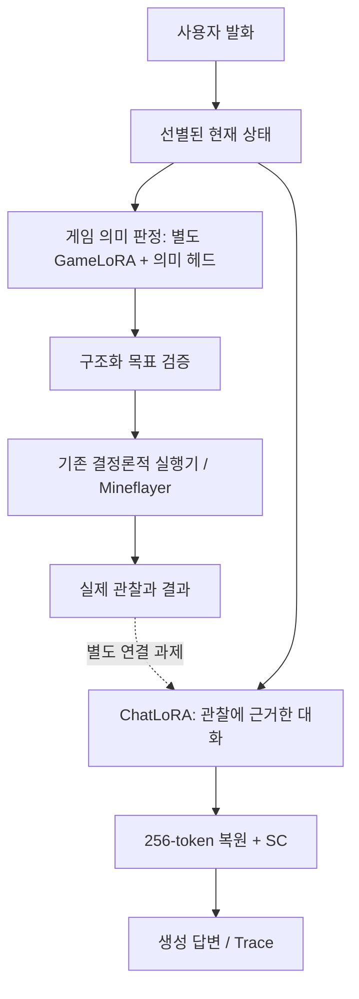

# Rubrum — 현재 구조와 확인한 범위

기준일: **2026-10-31** · [포트폴리오](../README.md) · [생성 과정 뷰어](https://snvoosy-arch.github.io/ai-companion-response-learning/diffusion-trace/) · [집계와 근거 식별값](../evidence/model-training/current-summary.json)

Rubrum은 한국어 대화와 게임 상호작용을 연구하는 개인 AI 컴패니언입니다. 현재 연구는 **SDAR-4B-Chat의 256-token uniform 복원과 self-conditioning(SC)**에 기반합니다. 과거의 BERT 의미 판정·단어 조립 구현은 설계 이력과 공개 CPU 예제로 보존하며, 현재 생성기의 설명과 구분합니다.

## 10월 30~31일 대화 경로의 변화

새 표준 실행기는 같은 SDAR의 동결 표현과 학습된 판정 헤드로 발화 종류·문맥·기억 조회의 검색 범위를 정합니다. 코드가 소스·사용자·채널·날짜 범위를 검사하고 SQLite에서 원문을 찾으며, 선택한 문맥과 근거로 Chat 자식이 답변을 생성합니다. `MEMORY_QUERY`와 `CLARIFY`에는 별도의 학습된 근거 대조가 적용됩니다. 일반 `CHAT`은 이 근거 대조의 적용 대상이 아닙니다.

거절 뒤 같은 입력으로 한 번 더 생성하고, 두 후보 모두 거절되면 모델 답변을 전송하지 않습니다. 후보 원문·형식 검사·근거 점수·오류·전송 결과를 처리 ID로 연결해 남기며, 다음 생성이 실패해도 앞선 후보는 보존합니다. 이는 기록 가능한 판단 구조가 생겼다는 뜻이며 의미 정확도가 완성됐다는 뜻은 아닙니다. [대화 판단·학습·실패·실채널 검증 상세](rubrum-model-led-dialogue.md).

## 대화와 게임 판단의 책임

이 그림은 구현된 구성요소와 연결 과제를 구분한 책임도입니다. 최신 모델을 일반 게임 채팅부터 행동·결과 대화까지 항상 연결한 완성 제품을 뜻하지 않습니다. **의미 해석은 무엇을 요청했는지, 실행 검사는 지금 할 수 있는지, 결과 관찰은 실제 무엇이 일어났는지**를 담당합니다. ChatLoRA가 “받았다”고 말해도 수령 사건이 확정되는 것은 아닙니다.

| 구성 | 확인한 내용 | 남은 경계 |
| --- | --- | --- |
| ChatLoRA + SC | 증류·게임 대화 부모에서 대화/근거 응답용 104개 고유 대화를 추가 적응 | 의미·수량·수령 근거 오류, 자연스러움과 종료 처리의 한계 |
| 대화 판단·기억 조회 | 경로·출처·기간·문맥·검색 문자 경계와 기록 관련성 판정 | 답글 대상 과다 선택, 일부 검색/기간 오판 |
| 생성 답변 대조·기록 | MEMORY_QUERY/CLARIFY 근거 대조와 최대 2후보, 후보별 원문·결과 로그 | 일반 CHAT 미적용, 소규모 평가의 오수락 1건 |
| GameLoRA + 8개 헤드 | 발화 종류·대상·수량·전달·산출물·장착 위치·모드·범위를 판정 | 긴 실제 상태 JSON에 민감, 새 기능의 양성 요청 정확도 부족 |
| 목표 검증 | 모델의 구조화 목표를 계약과 실행 가능 범위에 대조 | 목표 해석과 재료 부족을 혼동하지 않도록 데이터·계약 보완 필요 |
| 실행기 | 기존 이동·채집·제작·전달·제련 등 실행 코드가 존재 | 최신 모델의 모든 기능을 실전에서 검증한 것은 아님 |
| 계획 선택 | 현재는 결정론적 실행·작업 순서와 제한된 재시도 | 학습된 행동 후보 Ranker·자율 장기 계획은 미완료 |

SC는 이전 예측 분포 정보를 다음 복원에 반영하는 학습 경로입니다. 여기서 말하는 “DiffusionGemma식”은 공개 구현을 참고한 uniform 복원·종료 처리 실험이라는 뜻입니다. SDAR의 backbone을 그대로 사용하며, 실제 DiffusionGemma 모델 또는 공식 구조 전체를 재현했다고 주장하지 않습니다.

## 최근 학습의 계보

1. **10월 22일 FineWeb 단계:** 해당 시점까지 적응 학습 본문 토큰 32,113,100개. 이후 실험과 중복·재개 구간을 다시 합산하지 않았으므로 이 숫자를 최신 전체 누적으로 사용하지 않습니다.
2. **10월 26일 증류 대화 전체:** 20,830개 대화의 assistant 대상 22,284개, 본문 691,382토큰, 2,786 updates. 같은 256 uniform + SC 조건으로 1 epoch 학습했습니다.
3. **10월 28일 별도 게임 의미 판정:** intent 학습 840건·평가 200건, 105 updates. Chat 생성기와 역할이 다른 별도 GameLoRA·헤드입니다.
4. **10월 29일 게임 근거 대화:** 500행 중 학습 450·평가 50행. 직전 ChatLoRA·SC에서 이어서 본문 7,475토큰, 57 updates를 학습했습니다. BF16 본체는 고정하고 LoRA 504개·SC 6개 텐서를 변경했습니다.
5. **10월 30일 대화·근거 응답 자식:** 위 부모에서 고유 학습 104건, 독립 오염 canvas 312개, 39 updates. 평가 16문항의 고정 48 canvas에서 본문 loss 1.713372 → 1.438582, 종료·tail loss는 소폭 악화됐습니다. 판정 헤드는 새 자식의 hash에 고정했습니다. [후속 집계](../evidence/model-training/rubrum-dialogue-20261031.json).

대화 학습에는 시스템 프롬프트·공통 보조 지시·명시적 seed를 사용하지 않았습니다. 사용자 발화와 필요한 구조화 상태가 입력이며 assistant 답변을 복원합니다. 이 기록은 “프롬프트가 전혀 없는 모델” 또는 모델이 모든 상태를 자동 회상한다는 주장을 포함하지 않습니다.

## 무엇을 평가했는가

### 텍스트 복원과 생성 답변은 별도 평가

게임 근거 대화의 전후 복원 평가는 게임 50문항과 일상 20문항에 각각 세 노이즈 수준을 적용한 **210개 동일 canvas**입니다.

| 본문 복원 | 학습 전 loss | 학습 후 loss | 학습 전 토큰 정확도 | 학습 후 토큰 정확도 |
| --- | ---: | ---: | ---: | ---: |
| 게임 50문항 × 3 | 1.842505 | 1.671623 | 66.90% | 69.20% |
| 일상 20문항 × 3 | 1.815562 | 1.835818 | 68.25% | 68.57% |

전체 위치에는 EOS 채움이 많으므로 본문·실제 턴 종료·tail을 나눠 봅니다. 이 표는 문장 정답률이나 생성 성공률이 아닙니다.

별도 생성은 전후 게임 20개·일상 10개, 총 60개 답변입니다. 수동 기본 통과는 게임 3/20 → 6/20, 일상 5/10 → 2/10으로 관찰했습니다. 독립적인 초기 노이즈를 사용한 작은 비블라인드 표본이므로 **전체 대화 성능의 개선·악화를 확정하지 않으며, 자동 롤백 기준으로 쓰지 않습니다.** 최신 완료 가중치는 후속 누적 학습의 부모로 유지합니다. 학습 계보 선택과 Discord 운영 활성화는 별개입니다.

### 게임 의미와 실제 실행도 별도 평가

별도 GameLoRA의 200개 평가에서 raw 목표 전체 일치는 **117/200**, 발화 종류 일치는 **152/200**입니다. 새 기능 4종의 양성 요청 전체 일치는 **2/39**로 제한적입니다. 이는 합성 의미 평가이며 실제 채집·제작 성공률이 아닙니다.

10월 29일 실제 서버 시험에서는 실제 상태를 읽고 합성 요청 8개를 로컬에서 모델에 주입했습니다. raw 목표 일치는 **4/8**이었습니다. 실제 소지품 조회와 유휴 상태 중단을 호출했고, 별도 짧은 상태 조건에서는 이동 요청을 해석하여 **위치 변위 3.7648블록, 사용자와 최종 거리 1.9018블록**을 관찰했습니다. 변위는 총 보행 거리가 아닙니다.

흙 채집·착용은 의미만 확인했으며 실제로 실행하지 않았습니다. 채집·제작·전달·제련·섭취 전체와 일반 게임 채팅 입력 경로는 이 최신 모델 실전 시험의 검증 범위가 아닙니다. 이동 중 블록 파괴·발판 설치도 호출하지 않았습니다. 같은 이동 발화가 짧은 상태에서는 approach, 전체 재고 JSON에서는 defer가 되는 문맥 민감성 문제가 남았습니다.

## 새 공개 기능: 디퓨전 Trace 뷰어

[실행 화면 열기](https://snvoosy-arch.github.io/ai-companion-response-learning/diffusion-trace/). 내려받은 [index.html](diffusion-trace/index.html)을 직접 열거나 저장소 루트에서 `python -m http.server 8765` 실행 후 `/docs/diffusion-trace/`로 접속할 수도 있습니다. Node·Python 서버는 선택이며 브라우저만으로도 작동합니다.

- `P076`: 철 6개 중 관찰 산출 3개 → “세 개 나왔어.”, 14 복원 단계.
- `T078`: 떨어뜨린 수량 2개, 수령 여부 null → “두 개는 받았어.”, 22 복원 단계. 근거 없는 수령 단정입니다.

직접 작성한 합성 평가 상황에서 저장한 **실제 모델 출력** 두 건을 선별했습니다. 개인 대화 또는 실제 게임 결과를 가공한 데이터가 아닙니다. 두 사례로 일반 성능이나 오류 빈도를 추정하지 않습니다.

뷰어는 초기 canvas, 단계별 토큰·변경 위치·평균 entropy, argmax 예측 종료 위치, 실제 canvas 종료 위치, 최종 답변을 구분합니다. 원시 canvas는 재노이즈를 포함하므로 argmax 종료 위치와 다를 수 있습니다. 초기 노이즈에는 예측 entropy 측정이 없습니다. 마지막 단계와 별도로 정리된 최종 canvas도 JSON에 보존합니다.

`scripts/export_diffusion_trace.py`는 가중치를 로드하지 않고 두 기록만 명시적으로 추출합니다. 원본의 배열 길이·토큰 ID·변경 위치·entropy 평균·argmax 종료 위치·실제 최종 답변을 검사한 후 허용 필드만 내보냅니다. 토큰별 byte 조각의 대체 문자와 최종 문장 손상은 구분해야 합니다.

## 공개 범위와 다음 과제

공개하는 것은 선별된 합성 Trace, 집계, 뷰어와 검사 코드입니다. 개인 대화·계정 식별자·전체 학습 원문·가중치·DB는 포함하지 않습니다. 해시는 로컬 원본의 버전을 식별하며 원본 전체 공개나 학습 재현을 대신하지 않습니다.

다음은 답글 대상·검색 범위·기간 판정의 실패 보완과 실제 새 사용자 입력·근거 재생성 경로의 실채널 검증입니다. 10월 31일에는 기존 메시지 3건을 당시 기록의 별도 DB로 재실행해 실제 Discord 전송·재조회·후보 로그 일치만 확인했습니다. 세 건 모두 CHAT의 첫 후보였고 대화 품질은 짧고 단조로웠습니다. 원문과 식별자는 공개하지 않습니다. 게임 쪽 관찰 상태 계약, 수량·수령·부분 성공의 대조 학습과 결과 대화 연결도 별도 과제입니다. 게임 영상은 자연어 입력부터 행동·결과 확인까지 재검증한 다음 추가합니다. 자율 계획·모든 기능 실행·상시 접속은 완료 주장에 포함하지 않습니다.
