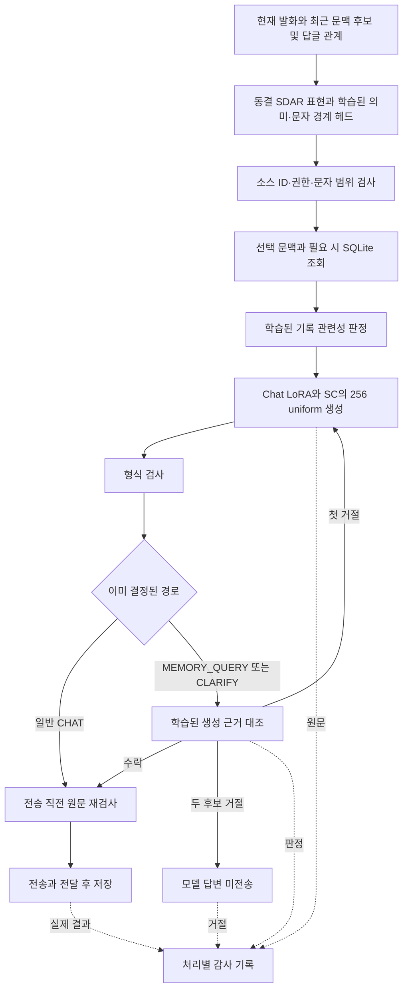

# Rubrum — 대화 판단·기억 조회·생성 후보 기록

기준일: **2026-10-31** · [현재 전체 구조](rubrum-current-architecture.md) · [근거 집계](../evidence/model-training/rubrum-dialogue-20261031.json) · [포트폴리오](../README.md)

이번 변화는 **모델이 문맥과 조회할 내용을 고르고, 원문 근거와 생성 답변을 대조한 뒤, 각 후보와 실제 전송 결과를 추적하도록 연결한 것**입니다. 주제별 고정 답변이나 이전 단어 조립기를 새 SDAR 표현기로 사용하는 구조가 아닙니다. 답글 대상 오판, 근거 오수락, 어색한 답변은 여전히 남아 있습니다.

## 현재 흐름과 책임

- **학습된 판단:** 대화/조회/확인 경로, 발화 출처, 기간, 문맥 선택, 원문 검색 범위, 기록 관련성, 근거 응답의 일치 여부.
- **코드의 경계:** 사용자·서버·채널, 소스 ID와 문자 범위, 날짜 계산, SQLite 사실, 수정·삭제·중복, 전송·저장.
- **생성:** 선택 문맥과 구조화 근거를 받은 Chat 자식. 코드가 답변을 고정 문장으로 교체하지 않습니다.

판정기는 같은 SDAR 자식의 clean hidden state를 공유합니다. 내부 래퍼 이름 `FrozenEncoder`는 별도 BERT나 물리적으로 분리된 인코더 모델을 뜻하지 않습니다. 시스템 프롬프트·공통 자연어 보조 지시·명시적 seed를 추가하지 않았지만, 구조화 데이터와 학습된 입력 형식은 사용합니다.

새 표준 실행기의 기본은 `model`입니다. 번들에 묶인 Chat 자식을 선택하며, 기존 registry alias나 별도 Game 부모를 일괄 승격한 것은 아닙니다. 판정 실패 때 이전 키워드 의미 판단으로 우회하지 않습니다. 기존 legacy/shadow 코드는 명시적 호환 선택으로 보존합니다.

## 무엇을 학습했나

| 구성 | 학습 자료 | 평가 자료·구분 |
| --- | --- | --- |
| Chat/SC 자식 적응 | 새 구조화 응답 64건 + 기존 일상 replay 40건 = 고유 104건 | 별도 16문항 × 고정 노이즈 3수준 = 48 canvas |
| 의미·문맥·문자 경계 | 기존 400건 + 후속 60건 = 460건 | 새 조합 40건과 이미 관찰한 역사 대조 100건 |
| 기록 관련성 보완 | 기존 80쌍 + 다른 대상 질문의 음성 40쌍 = 120쌍 | 보류 20쌍과 역사 대조 40쌍 |
| 생성 근거 대조 | 지원되는 교사 응답 55쌍 + 개별 작성 오답 55쌍 = 110쌍 | 양성 10쌍 + 음성 10쌍 = 20쌍 |

Chat 적응은 104개 고유 학습 대화에 독립 오염을 3회 적용한 **312 canvas·39 optimizer updates**입니다. 새 대화 312개가 아닙니다. 본체는 고정하고 LoRA/SC만 적응한 뒤 작은 판정 헤드를 학습했습니다. 기록 후보 쌍도 고유 대화 수에 합산하지 않습니다.

| 고정 검증 입력의 복원 loss | 이전 | 이후 |
| --- | ---: | ---: |
| 본문 | 1.713372 | 1.438582 |
| 실제 턴 종료 | 0.517930 | 0.535806 |
| EOS 채움 tail | 0.001406 | 0.003406 |

본문은 낮아졌고 종료·tail은 소폭 높아졌습니다. 이 수치는 문장 정답률이나 자연스러움 비율이 아닙니다.

## 무엇이 맞고 틀렸나

| 새 조합 대화 판정 | 결과 |
| --- | ---: |
| 경로 전체 일치 | 34/40 |
| 발화 출처 | 39/40 |
| 기간 종류 | 37/40 |
| 문맥 집합 전체 일치 | 31/40 |
| 문맥 후보가 주어진 부분의 전체 일치 | 6/15 |
| 명시적 답글 대상 대조 부분 | 0/6 |
| 검색 문자 범위 전체 일치 | 28/40 |
| 검색 범위가 있는 부분의 전체 일치 | 14/24 |

답글 관계를 입력에 넣었지만 6개 대조 사례 모두 불필요한 다른 후보까지 골랐습니다. 전체 문맥 31/40만으로 이 실패를 가리지 않습니다. 역사 대조 100건은 이미 본 평가이며 새 독립 성적으로 부르지 않습니다. 이전 token-span 결과와 현재 문자 범위 결과도 직접 증감 비교하지 않습니다.

기록 관련성 보완 후 보류 평가가 **18/20 → 16/20**으로 내려갔고, 이후 오수락은 0건이었습니다. 더 보수적으로 판단하며 실제 관련 기록도 더 놓쳤습니다. 생성 근거 대조는 **19/20, 오수락 1건**입니다. 작은 이진 대조 결과이지 보편적인 사실성 보장은 아닙니다. 원점수는 보정된 확률도 아닙니다.

실제 4B와 최종 bridge를 사용한 오프라인 8건에서는 5건이 전송 fixture의 검사까지 통과했습니다. 이는 의미 정답 5/8이 아닙니다. 답글 대상 오판과 검색 범위·기간 판정 실패가 남았습니다. 지원되는 양성 대조군의 전체 연결도 확인했지만, 학습에 포함된 표현이므로 새 표현 일반화 성적으로 세지 않습니다.

## 첫 답변이 거절되면 무엇이 남나

비공개 runtime은 다음을 생성·판정 시점마다 기록합니다.

1. 사용자 입력·선택 문맥·의미 판정·조회 근거.
2. 각 후보의 검사 대상 문장, 디코딩 원문, 형식 검사, 생성 회차와 내부 형식 재시도 번호.
3. 적용 대상인 경우 근거 판정의 수락/거절과 raw logit, 생성·판정 오류.
4. 전송 직전 시도, 확인된 전송, 전송 전 차단, 전송 중 오류로 수신 여부를 모르는 상태.

동일한 처리 ID로 연결하고 다음 생성 전에 저장합니다. 첫 거절 뒤 다음 생성이나 형식 검사에서 오류가 나도 앞선 기록이 남습니다. 거절 후보는 실제 전달된 대화 기억이나 자동 학습 자료로 넣지 않습니다. 과거 해시에서 옛 원문을 복원할 수는 없고, JSONL 쓰기가 전원 차단까지 보장하는 저널도 아닙니다.

**근거 검사 후보 최대 2회**와 기존 **회차별 형식 재시도 최대 2회**는 다릅니다. 최대 4개의 디코딩 후보가 나올 수 있으며, 이번 기록 보완이 생성 예산을 늘린 것은 아닙니다. 일반 CHAT에는 생성 근거 대조 이벤트가 없습니다. 예외를 정상적인 거절 점수로 기록하지 않습니다.

## 실제 채널에서 확인한 범위

10월 31일 사용자가 승인한 기존 메시지 **3건**을 원래 작성 시각과 당시 과거 기록의 별도 DB로 재실행했습니다. 같은 실제 SDAR·판정 경로로 생성한 답변을 원래 메시지에 실제 Discord 답글로 보내고, API로 다시 읽어 **3/3 본문·답글 대상·후보 원문 로그·전송 결과 해시 일치**를 확인했습니다. 운영 대화 DB는 바뀌지 않았습니다.

세 건 모두 일반 CHAT의 첫 후보였습니다. 근거 거절·두 번째 생성이나 새 사용자 Gateway 입력부터의 실전 시험은 아닙니다. 응답은 짧고 단조로웠으며, 전송 성공을 대화 품질 통과로 세지 않습니다. 개인 대화와 채널·작성자 식별자는 공개하지 않습니다. 시험 후 모델과 임시 접속을 종료했습니다.

첫 재실행 도구는 정상 실행기의 지연 모델 로딩 단계를 빠뜨려 생성 전에 중단됐습니다. 이 준비 오류를 수정한 두 번째 실행에서 위 전송을 확인했습니다. 실패 기록은 비공개 원본에 보존했습니다.

## 검증과 남은 일

- 관련 비공개 CPU 테스트 **114개**와 변경 Python 컴파일 검사가 통과했습니다. 공개 저장소의 CPU 표본 테스트 수나 전체 저장소 회귀 수와 구분합니다.
- 다음 생성·형식·판정 오류 뒤 후보 보존, 사용자/채널 분리, 거절 후보의 기억 미편입, 전송 오류의 불확실 상태 등을 검사했습니다.
- 답글 대상·검색 범위·기간 판정, 한국어 자연스러움, 실제 사용자 입력과 근거 재생성의 실채널 확인이 남았습니다.
- CLARIFY 입력의 `review_complete`가 교사와 runtime에서 다릅니다. 영향의 인과는 아직 확인하지 않았습니다.
- 기존 근거 대조 학습 manifest에는 입력 하나의 해시가 누락됐습니다. 후속 배포 원장에 현재 해시를 남겼지만 학습 당시 provenance가 완전히 복원됐다는 뜻은 아닙니다.
- Minecraft의 학습된 행동 후보 Ranker·자율 장기 계획·모든 행동의 실전 성공은 이번 작업의 완료 범위가 아닙니다.

공개 자료는 [선별 집계와 원본 버전 해시](../evidence/model-training/rubrum-dialogue-20261031.json)입니다. 최신 비공개 runtime·학습 코드·가중치·개인 로그를 공개하거나 공개 파일만으로 전체 학습을 재현한다고 주장하지 않습니다. 이전 [공개 CPU 예제](../companions/rubrum/README.md)는 이전 구조의 표본으로 유지합니다.
