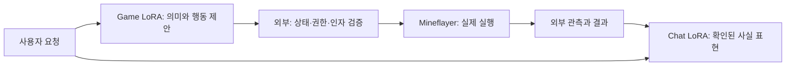

# Sapphirus — 현재 구조와 확인한 범위

기준일 **2026-10-30**. [실제 답변 비교 뷰어](https://snvoosy-arch.github.io/ai-companion-response-learning/sapphirus/) · [현재 학습 집계](../evidence/model-training/current-summary.json) · [CPU 실행 예제](../examples/sapphirus_current/README.md)

## 목표와 책임

생성형 모델이 자연스러운 대화와 고수준 행동을 제안하고, 실제 권한·도구 실행·관측 근거·전달은 외부 시스템이 소유하는 한국어 AI 컴패니언이다.

동일한 **Qwen3.5-4B** 원본에서 **Chat LoRA**와 **Minecraft Game LoRA**를 별도 학습한다. 모델에 경로 계산·블록별 조작을 맡기지 않고, 실행기가 이동·탐색·채굴·회수를 수행한다. 서로의 LoRA를 초기값으로 사용하지 않는다.

이 그림은 **통합 목표 구조**다. 최신 Chat·Game의 전체 실행 루프가 이미 연결됐다는 뜻은 아니다. 아래에서 구현·오프라인 출력·실제 접속 시험을 구분한다.

## 현재 Chat: 누적 학습본 하나

`daily_chat_sft_24030_20261018_r7`에서 `minecraft_chat_sft_20261029_r1`으로 이어 학습했다. 후자가 현재 Chat 선택이며, 다음 학습도 이 가중치에서 시작한다. 완료·저장 검증과 부모 해시 확인 뒤 현재 선택을 갱신한다. 실패·중단·부모 충돌은 현재 선택을 바꾸지 않는다. 이전 체크포인트는 이력·복구용으로 보존한다.

누적되는 것은 **모델 가중치**다. 새 실행의 optimizer·scheduler는 초기화한다. 현재 모델을 선택했다고 모델이나 Discord가 자동 시작되지는 않는다. 새 범용 계속학습 진입점은 CPU 경로를 검사했으며, 그 진입점 자체의 GPU 학습은 아직 실행하지 않았다. 아래 실제 학습은 해당 실행 전용 학습기로 완료한 기록이다.

| 항목 | 실제 기록 |
| --- | --- |
| 이전 일상 단계 | 24,030개 대화 · 24,122개 assistant 학습 대상 |
| 이번 추가 자료 | Minecraft 상황 대화 학습 200 / 개발 50 / 최종 50 |
| 학습 설정 | BF16, 언어층 LoRA rank 8 / alpha 16, 1 epoch, 13 updates |
| 평균 학습 loss | 1.740194 |
| 같은 개발 50문항 loss | 2.142194 → 1.646907 |
| 현재 adapter SHA-256 | `e2f753c24a51d9e2f42c1560d7cdfef020518a72afa1cced6e54eff0ae326e3f` |

시스템 메시지·매회 공통 자연어 지시 없이 user/assistant 형식으로 학습한다. 게임 상황에는 사용자 발화와 외부 상태를 구조화해 전달한다. **입력 문맥이나 tokenizer의 chat template까지 없다는 뜻은 아니다.** 사용자 문맥은 loss에서 제외하고 답변과 종료 토큰을 학습한다.

자료는 Codex가 문항별 직접 작성한 teacher SFT 자료다. 템플릿·seed 문장 확장과 학생 출력 재활용을 사용하지 않는다. 학습과 평가를 분리하고 spent 평가 문항·정답·실패 출력을 학습에 재사용하지 않는다.

## 실제 답변: 근거와 자연스러움을 따로 본다

같은 BF16 원본에 r7/추가 누적본을 탑재해 동일 입력을 greedy로 생성했다. Minecraft 50쌍 + 새 일상 12쌍, 총 **124개 응답**을 모델 이름을 가린 상태에서 Codex가 수동 판정했다. 독립적인 사람 평가나 통계적 벤치마크는 아니다. 모두 정상 종료했다.

| 지표 | 이전 r7 | 현재 누적본 |
| --- | ---: | ---: |
| Minecraft 사용 가능 | 26/50 | 33/50 |
| Minecraft 표현 품질 평균 / 2 | 1.80 | 1.94 |
| 일상 사용 가능 | 9/12 | 11/12 |
| 일상 표현 품질 평균 / 2 | 1.58 | 1.33 |
| Minecraft 쌍대 선호 | 8 | 17 |
| Minecraft 동률 | 25 | 25 |

사용 가능은 **근거 충족 + 표현 품질 1 이상 + 정상 종료**다. 표현 품질 0은 사용 가능한 발화 없음, 1은 어색함, 2는 자연스러움이다. 자연스러운 오답도 근거 실패로 남긴다. 근거 충족은 상태·수량·종류·완료 여부 등 필요한 사실에 대한 수동 판정이며 자동 entailment가 아니다.

이 표본에서 상태 설명의 개선 신호가 있지만 미확인 완료 동의, 실행 불가능한 대안, 부분 수량 단정이 남았다. 일상 12건의 점수 차이로 일반 대화 성능의 상승·하락을 확정하지 않는다. loss 감소와 생성 품질도 별도 지표다. 최종 50과 일상 12는 **spent**이며 재실행·학습 재사용하지 않는다.

뷰어의 6건은 전체 50건 중 설명을 위해 고른 개선 4건·남은 오류 2건이다. 화면의 답변과 판정은 저장 기록 그대로이며, 모델을 새로 실행하거나 AR 생성 token trace를 만들어 붙이지 않았다.

## Game LoRA와 실제 게임은 다른 검증 단계

- 최신 joint53 Game LoRA는 학습 1,000 / 개발 100. 새 최종 50에서 JSON 50/50, 계약 38/50, 완전 일치 **32/50**이다. 요청 해석 14/30, 후보 선택 18/20이며, 후보 선택은 외부가 준 올바른 목표를 조건으로 한 별도 과제다.
- 행동 요청 20건은 도구 이름 18/20, 인자까지 일치 9/20이다. 53개는 정의·학습한 고수준 행동 목록이며 실제 실행기 53개가 완성됐다는 뜻이 아니다.
- 기존 실행기는 이동·원목 채집 범위다. 제한된 서버 smoke 시험에서 대화 분기 1건은 통과했지만 행동 제안 2건은 인자 계약으로 거절돼 실제 이동·채집은 **0회**였다. selector도 실행되지 않았다.
- 그 시험은 고정된 새 문장을 시험 host에 직접 입력했다. 일반 사용자 게임 채팅 수신부터 전체 루프를 통과한 시험이 아니다. 서버 관측과 일부 실행기 연결이 최신 두 LoRA 전체 통합의 성공을 보장하지 않는다.

후속 grounded 상태 자료 300개(학습 200 / 개발 50 / 최종 50)도 준비했지만 아직 Game 학습·host에 연결하지 않았다. Chat 추가 학습에 사용한 상황 대화 300개와는 별도 자료다.

## Discord와 공개 코드의 범위

2026-10-29에는 학습된 r7을 8비트 원본에 붙여 제한된 두 테스트 채널에 연결했고 이후 종료했다. 다음 실행의 기본 선택은 최신 누적 Chat이지만, 이 새 선택으로 실제 연결한 상태는 아니다. 모델·봇은 종료 상태를 유지한다.

공개한 [현재 CPU reference](../examples/sapphirus_current/README.md)는 새로 작성한 가상 fixture로 행동 인자·완료 근거·누적 모델 선택의 경계를 실행한다. 개인 런타임 전체 복사본, 실제 tensor 검증기나 게임 executor는 아니다. 자연어 답변의 모든 잘못된 주장을 외부가 자동 검출한다고 주장하지 않는다.

이전 [8B 케이스스터디](sapphirus-case-study.md)와 [3-action CPU reference](../examples/sapphirus_external_first/README.md)는 당시 계보로 보존한다. 과거 temporal/RAG 성적을 새 4B나 실제 Minecraft 성적으로 옮기지 않는다.
